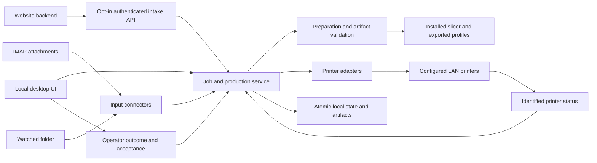

# Architecture and PS AM Print reuse

QuickPrint follows PS AM Print's separation between request intake, file preparation, printer dispatch and production reconciliation. Its initial desktop implementation packages those responsibilities in one Electron application with a local Node service. It does not depend on a running PS AM portal, Bambuddy Python service or external database server.

## Components

| Location | Responsibility |
| --- | --- |
| `src/desktop/` | Electron window lifecycle, sandboxed preload bridge, native file/folder selection, Windows account credential encryption |
| `src/server.js` | Authenticated loopback administration API, optional separate website intake listener, printer polling and connector lifecycle |
| `src/core/` | Persistent jobs/printers/settings, submission identities, dispatch/run state machine, production quantities, atomic storage and profile lock |
| `src/connectors/` | Stable-file monitoring and read-only IMAP attachment ingestion with persistent checkpoints |
| `src/slicing/` | Prepared-file inspection, configured slicer invocation, output checks, hashes and target-printer binding |
| `src/adapters/` | Explicit registry of OctoPrint, Moonraker, Bambu LAN and standalone Duet protocol implementations |
| `src/renderer/` | Overview, job workflow, fleet connections, inputs and settings UI |

Adapters expose normalized status plus upload/start/pause/resume/cancel capabilities. Protocol-specific credentials and request formats stay within their implementations. Adding another printer protocol requires a reviewed source adapter and tests; QuickPrint does not execute plugin code received from printers or imported files. Reachability or a nominal model name does not establish capability.

Connectors call the same `submit()` service used by manual and website uploads. The identity is `(source, sourceId)`, not just a file-content hash. This lets retries return existing jobs while permitting repeated customer orders for identical models.

## Job and production model

A submission groups one or more files; each file creates one job. A job retains its original, preparation result, selected printer, requested file-copy quantity and run history. Preparation binds the output to the selected printer/configuration and records artifact/profile hashes.

Dispatch serializes access to the job and printer. It checks the prepared artifact and fresh idle telemetry, persists upload/start intent, then invokes the adapter. A failed upload before any start can return to ready. A start with an ambiguous result becomes an operator hold instead of being resent automatically.

Telemetry is associated with QuickPrint's own remote file/run identity. An unrelated print or an idle snapshot cannot silently complete a QuickPrint job. Printer completion and production acceptance remain separate. One run can contribute at most one accepted file-copy, and another run requires another explicit start. The job is complete only when accepted quantity satisfies its requested quantity.

State is stored in versioned JSON under the supplied data directory with atomic replacement and a single-service lock. Original and prepared artifacts live in per-job folders. Connector checkpoints are separate atomic files within the same data directory. After restart, interrupted preparations and active/uncertain runs are brought back to a reviewable state rather than automatically dispatched.

## Local and network boundaries

The administration API listens on loopback and uses a per-process token. Electron loads only that local origin, disables Node access in the renderer and exposes a narrow native bridge. Ordinary state snapshots do not reveal mailbox/printer credentials.

Website intake has its own persistent bearer token and an opt-in listener. It accepts submissions and health requests but exposes no administration or order lookup. VPN/reverse-proxy/remote-delivery infrastructure is configured externally. Folder and email imports require no public inbound listener.

On Windows, desktop credentials use Electron safe storage backed by the signed-in Windows account. Browser/developer operation uses the core's local encrypted storage, whose local key must be protected with the data folder. Neither method makes an entire data backup safe to publish: original customer files, metadata and operational history remain private application data.

## Reused source and intentional scope

`src/slicing/psam/zip-inspection.js` reuses bounded ZIP inspection/read helpers, slice metadata parsing and printer-model normalization from PS AM Print's `slicer-output-validator.js`, taken from `3dprintingworldinc-lang/psam-server-transition` commit `74941370890ce3fe26ed43deb475b221b4a387d3`. Desktop limits were reduced. The exact provenance and rights note is in [NOTICE.md](../src/slicing/psam/NOTICE.md).

PS AM's stage separation, preserved originals, validated output, identity-aware dispatch and accepted-quantity reconciliation inform QuickPrint's design. The source reuse does not mean the full portal or production system has been ported. This release does not include PS AM-specific PDM integration, Windows-group role policies, material/hardware catalogues, geometry-aware multi-job plate batching, separate STEP orientation engine, automated plate clearing or unattended repeat dispatch.

The desktop provides one local operator workspace. Multi-tenant hosting, user-account roles, automatic printer discovery, a public storefront, outgoing customer notifications and OAuth mailbox authorization are outside the initial implementation. Future additions should use the existing intake, preparation and adapter boundaries without bypassing run identity or acceptance checks.

## Validation boundary

Tests use temporary data profiles, local protocol fixtures, injected mailbox clients and prepared-file/slicer fixtures. They cover persistence, duplicate delivery, artifact validation, protocol schemas, credential redaction and uncertain dispatch behavior without operating production printers. Browser and desktop smoke tests exercise the local UI/runtime separately.

A Windows build has additional packaged startup and credential-encryption checks in the GitHub workflow. Results are specific to the build actually run. Physical print qualification, mailbox-provider access, exact slicer/preset combinations and a deployed website route still require checks on the destination PC and hardware.
